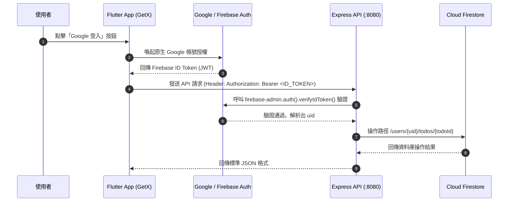

# 系統架構與技術設計書 (DESIGN.md)

## 1. 技術選型總覽 (Tech Stack)

| 層次 | 技術選型 | 版本 / 工具 | 決策重點說明 |
| :--- | :--- | :--- | :--- |
| **開發方法論** | **TDD (測試驅動開發)** | Red ➔ Green ➔ Refactor | 堅持未測先寫禁止原則，先由規格擬定單元與整合測試，測試失敗後才撰寫最小可行程式碼 |
| **前端應用** | **Flutter** (Dart) | 跨平台行動應用 (iOS / Android) | 嚴格遵守 **MVC 分層 (Entity / DTO / Retrofit ApiService / Controller / View)** |
| **前端狀態管理** | **GetX** (`get`) | 路由、依賴注入、響應式狀態 | 簡潔的依賴注入 (`Bindings`)、響應式變數 (`Rx`, `Obx`) 與即時視圖重繪 |
| **網路傳輸** | **Dio + Retrofit** | `retrofit`, `dio`, `json_annotation` | 宣告式 RESTful API 介面，搭配 Dio Interceptor 自動掛載 Firebase Bearer Token |
| **第三方認證** | **Firebase Auth** | `google_sign_in`, `firebase_auth` | 原生 Google 登入換取 Firebase ID Token，作為後端無狀態鑑權憑證 |
| **後端伺服器** | **Node.js + Express** | 原生測試執行器 (`node --test`) | 輕量化 REST API 架構，提供 Middleware 鑑權、輸入校驗與 Firestore 存取 |
| **資料庫儲存** | **Cloud Firestore** | `firebase-admin` SDK | Google Cloud NoSQL 文件資料庫，利用使用者子集合實現天然資料隔離 |

---

## 2. 專案目錄架構 (Monorepo Layout)

```text
c:\Workspace\GrillMeDocDemo\
├── .agents/
│   └── skills/
│       └── grill-me-doc/            # 深度訪談與規格文檔化 Skill
├── SPEC.md                          # 功能與需求規格書（含領域術語表）
├── DESIGN.md                        # 系統架構與技術設計書（含 ADR）
├── frontend/                        # Flutter 前端專案 (嚴格 MVC 分層)
│   ├── test/                        # TDD 單元測試、Mock 服務與 Controller 測試
│   └── lib/
│       ├── main.dart
│       └── app/
│           ├── routes/              # AppPages, AppRoutes
│           ├── data/
│           │   ├── entities/        # 領域實體（如 TodoEntity）
│           │   ├── dtos/            # 資料傳輸物件（如 TodoDto, UpsertTodoDto）
│           │   └── services/        # Retrofit ApiService 與 Dio Client
│           └── modules/
│               ├── auth/            # 登入模組 (Binding, Controller, View)
│               └── todo/            # 待辦清單模組 (Binding, Controller, View, Widgets)
└── backend/                         # Node.js + Express 後端專案
    ├── package.json
    ├── server.js                    # 監聽入口 (預設 Port 8080)
    ├── src/
    │   ├── app.js                   # Express 應用設定與路由裝配
    │   ├── config/                  # Firebase Admin 設定
    │   ├── middleware/              # AuthMiddleware (Token 驗證)
    │   ├── models/                  # 資料校驗模型 (todoValidator)
    │   └── routes/                  # API 路由實作
    └── test/                        # 後端 TDD 單元與 API 整合測試
```

---

## 3. 身分驗證與資料安全流程 (Auth & Security Flow)



* **Firebase 專案與客戶端憑證設定（已沿用 `cullio` 專案）**：
  * **Firebase Project ID**：`cullio`（Project Number: `590561728933`）
  * **Android Package Name**：`com.cullio.android`（設定檔：`google-services.json`）
  * **iOS Bundle ID**：`com.cullio`（設定檔：`GoogleService-Info.plist`）
  * **iOS URL Scheme (`REVERSED_CLIENT_ID`)**：`com.googleusercontent.apps.590561728933-6cjm09g6jksp28nmmv8u3tpamjmhihef`
  * **Web OAuth Client ID (`client_type: 3`)**：`590561728933-fjn1uljkjagqhftnbjaq62btm6q8g87k.apps.googleusercontent.com`
  * **後端認證私鑰**：預期透過環境變數 `GOOGLE_APPLICATION_CREDENTIALS` 或放置於 `backend/serviceAccountKey.json` 進行初始化。

---

## 4. 資料模型與結構 (Database Schema)

* **Firestore 集合路徑**：`/users/{uid}/todos/{todoId}`
* **資料結構範例**：

```json
{
  "id": "doc_abc123",
  "title": "完成專案架構文件確認",
  "dueDate": "2026-11-20",
  "state": "in progress",
  "category": "company",
  "createdAt": "2026-11-11T16:00:00.000Z",
  "updatedAt": "2026-11-11T16:30:00.000Z"
}
```

* **列舉值限制**：
  * `state`: `"todo"` | `"in progress"` | `"done"`
  * `category`: `"company"` | `"personal"` | `"other"`
  * `dueDate`: 符合正則 `^\d{4}-\d{2}-\d{2}$` 且須為有效西元曆日期。

---

## 5. 後端 RESTful API 規格

| HTTP 方法 | API 路徑 | 授權要求 | 說明 | 成功回傳代碼 |
| :--- | :--- | :---: | :--- | :---: |
| `GET` | `/health` | 免驗證 | 伺服器健康檢查 | `200 OK` |
| `GET` | `/api/v1/todos` | 需 Bearer Token | 取得當前使用者的所有待辦事項 | `200 OK` |
| `POST` | `/api/v1/todos` | 需 Bearer Token | 新增待辦事項 | `201 Created` |
| `PUT` | `/api/v1/todos/:id` | 需 Bearer Token | 更新指定待辦事項內容或狀態 | `200 OK` |
| `DELETE` | `/api/v1/todos/:id` | 需 Bearer Token | 刪除指定待辦事項 | `200 OK` |

---

## 6. 架構決策記錄 (Architecture Decision Records, ADRs)

### ADR-001: 採用 Google Sign-In 與 Firebase Auth ID Token 無狀態鑑權
* **狀態**：Accepted
* **背景**：系統需要可靠的跨平台身分識別機制，同時後端 API 必須具備無狀態（Stateless）驗證能力。
* **決策**：
  1. 前端透過 `google_sign_in` 與 `firebase_auth` 取得 Firebase ID Token。
  2. 每次 API 請求於 Header 帶入 `Authorization: Bearer <ID_TOKEN>`。
  3. 後端 Express 使用 `firebase-admin` 官方 SDK 驗證簽章並獲取唯一 `uid`。
* **優點**：免去自行維護密碼雜湊與 Refresh Token 的資安風險；天然提供使用者級別的資料隔離機制。

---

### ADR-002: 前端採用 Flutter MVC + Retrofit + GetX 分層架構
* **狀態**：Accepted
* **背景**：前端需要清楚切分資料層、業務層與視圖層，並支援嚴格的 TDD 單元測試。
* **決策**：
  1. **Entity**：純領域實體，代表核心商業模型，不包含 JSON 轉換細節。
  2. **DTO**：負責與遠端 API 交換資料，具備 `toJson()`、`fromJson()` 與 `toEntity()` 方法。
  3. **Retrofit ApiService**：以介面方式定義 API 端點，支援方便替換為 Mock 服務進行測試。
  4. **GetX Controller**：承擔業務協調與響應式狀態維護，不直接操作 UI 元件。
  5. **View**：純 UI 宣告與樣式呈現，無內部邏輯。
* **優點**：各層職責單一，模組易於進行獨立 Unit Testing 與 Mock 注入。

---

### ADR-003: 資料庫路徑採用使用者子集合 (`users/{uid}/todos/{todoId}`)
* **狀態**：Accepted
* **背景**：在 Cloud Firestore 中需要設計支援高效查詢與嚴格資料隔離的結構。
* **決策**：
  不採用扁平的根目錄集合配 `where("uid", "==", uid)` 查詢，而是直接將 todos 掛載在特定使用者底下的 Subcollection。
* **優點**：
  1. 資料完全天然隔離，杜絕意外跨帳號資料外洩。
  2. Firestore 安全規則（Security Rules）簡潔明確，查詢效能佳且無需建構複合索引。

---

### ADR-004: 全端實施嚴格 TDD（測試驅動開發）紅綠循環
* **狀態**：Accepted
* **背景**：為避免 AI 代理產生幻覺程式碼與無效邏輯，保障程式碼質量與重構信心。
* **決策**：
  1. 所有後端 API 與前端 Controller / DTO 均嚴格遵守 **Red ➔ Green ➔ Refactor** 流程。
  2. 在撰寫任何業務邏輯程式碼前，必須先有對應失敗的測試（Red）。
  3. 通過測試後才可進行代碼重構（Refactor）。
* **優點**：程式碼覆蓋率高，規格完全受測試保護，任何回歸錯誤能被即刻捕捉。

---

### ADR-005: 資料載入維持全量載入前端即時排序，暫不導入分頁
* **狀態**：Accepted
* **背景**：評估一般個人待辦事項的資料量級（通常數十至數百筆以內）。
* **決策**：
  API 一次傳回該使用者的全部 Todo，由前端 GetX 依據到期日快速進行本地 ASC / DESC 重排。
* **優點**：
  使用者切換排序時零網路延遲，UI 體驗流暢；避免早期過度設計分頁帶來的狀態複雜度。

---

### ADR-006: 待辦事項刪除機制採用硬刪除（Hard Delete）
* **狀態**：Accepted
* **背景**：需要確定待辦事項從列表刪除時，在資料庫層面採用標記軟刪除（Soft Delete）還是實體刪除（Hard Delete）。
* **決策**：
  呼叫 `DELETE /api/v1/todos/:id` 時，後端直接自 Cloud Firestore 子集合中執行 `.delete()` 移除該文件，不保留 `isDeleted` 標記。
* **優點**：
  1. 資料庫結構乾淨，不殘留過期垃圾資料。
  2. 查詢端不需要額外過濾 `where("isDeleted", "==", false)`，省去索引複合查詢成本。
  3. 符合 MVP 階段輕量、精確的設計原則。
